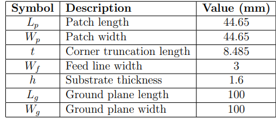
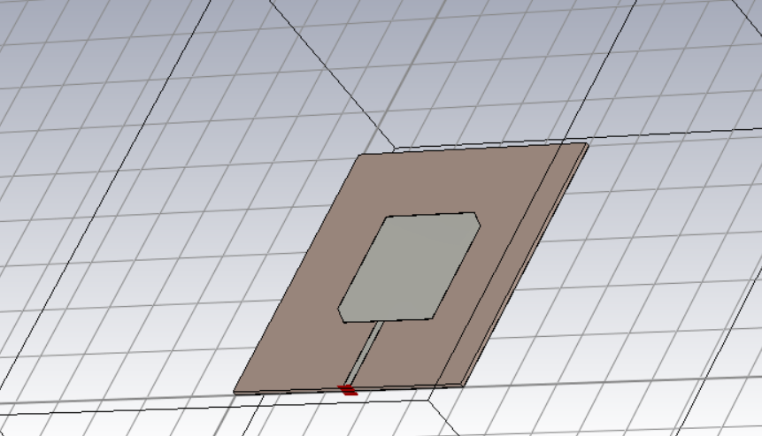
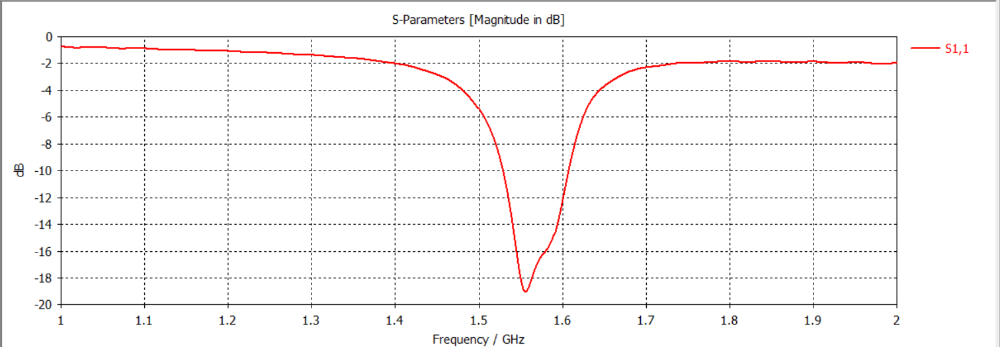
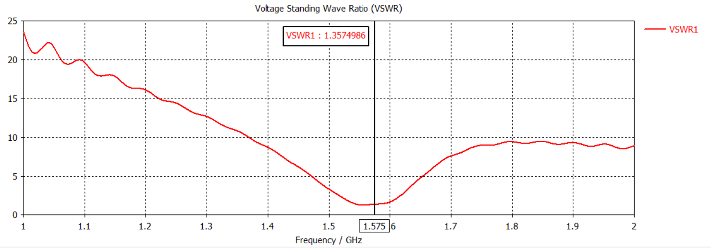
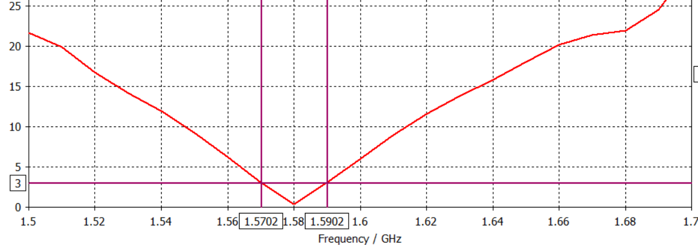
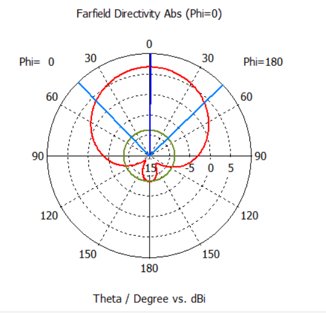
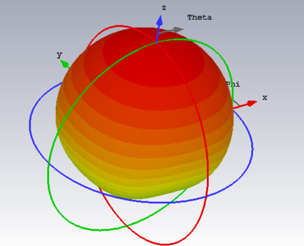

# GNSS L1 RHCP Microstrip Patch Antenna

Electromagnetic design and CST Microwave Studio simulation of a corner-truncated right-hand circularly polarized (RHCP) microstrip patch antenna targeting GPS/GNSS L1.

## Project Overview

| Item | Description |
|---|---|
| Application | GPS / GNSS L1 |
| Target frequency | 1.575 GHz |
| Antenna | Corner-truncated microstrip patch |
| Polarization objective | RHCP |
| Simulation tool | CST Microwave Studio |
| Substrate | FR-4 (as documented in the project work) |

The corner truncations are used to excite two orthogonal patch modes with a relative phase suitable for circular polarization. The work includes geometry definition, feed configuration, impedance matching, axial-ratio evaluation, and far-field analysis.

## Antenna Model and Geometry

### CST model

### Design dimensions

| Parameter | Description | Value |
|---|---|---:|
| $L_p$ | Patch length | 44.65 mm |
| $W_p$ | Patch width | 44.65 mm |
| $t$ | Corner truncation length | 8.485 mm |
| $W_f$ | Feed-line width | 3 mm |
| $h$ | Substrate thickness | 1.6 mm |
| $L_g$ | Ground-plane length | 100 mm |
| $W_g$ | Ground-plane width | 100 mm |

## CST Simulation Results

All results below are **simulated**, not measured on a fabricated prototype.

### Input matching

At the GPS L1 target frequency of 1.575 GHz, the plotted VSWR marker is approximately **1.3575**, corresponding to an estimated S11 of about **-16.4 dB**. The deepest S11 notch in the supplied sweep is approximately **-19 dB near 1.555 GHz**.

This indicates that the deepest impedance resonance is slightly below the 1.575 GHz target. Further tuning could move the minimum closer to the L1 center frequency while maintaining the circular-polarization performance.

### Circular polarization

The plotted 3 dB axial-ratio crossings are approximately **1.5702 GHz** and **1.5902 GHz**, giving a simulated **20 MHz axial-ratio bandwidth**. The GPS L1 target frequency of 1.575 GHz lies inside this interval.

### Far-field pattern

The supplied plots show the 3D far-field visualization and a 2D directivity cut at $\phi = 0^\circ$. A numerical peak gain/directivity value is not stated because a clearly readable peak marker is not available in the supplied screenshots.

## Summary of Extracted Results

| Metric | Result |
|---|---:|
| Target frequency | 1.575 GHz |
| VSWR at 1.575 GHz | 1.3575 |
| Estimated S11 at 1.575 GHz | -16.4 dB |
| Minimum plotted S11 | Approximately -19 dB near 1.555 GHz |
| Axial-ratio 3 dB band | 1.5702–1.5902 GHz |
| Axial-ratio bandwidth | 20 MHz |

## Project Files

- `antennadesign.cst` — CST Microwave Studio antenna model.
- [Lab report (PDF)](Lab_report%20(1).pdf) — project report and supporting documentation.
- `assets/` — CST model screenshots, dimensions, matching, axial-ratio, and far-field plots.

## Tools and Engineering Topics

- CST Microwave Studio
- Microstrip patch antenna design
- GNSS / GPS L1
- RHCP and circular polarization
- Corner truncation
- Impedance matching
- S-parameters and VSWR
- Axial-ratio bandwidth
- Far-field radiation-pattern analysis

## Scope and Reproducibility

Open the `.cst` project in CST Studio Suite to inspect the model and simulation setup. Values extracted from plots are approximate where noted. The S11 value at 1.575 GHz is estimated from the displayed VSWR marker. All numerical results represent simulation performance unless independently confirmed by prototype measurements.

---

**Author:** Ziad Ahmed Fergany  
**Focus:** RF & Microwave Engineering · Antenna Design
